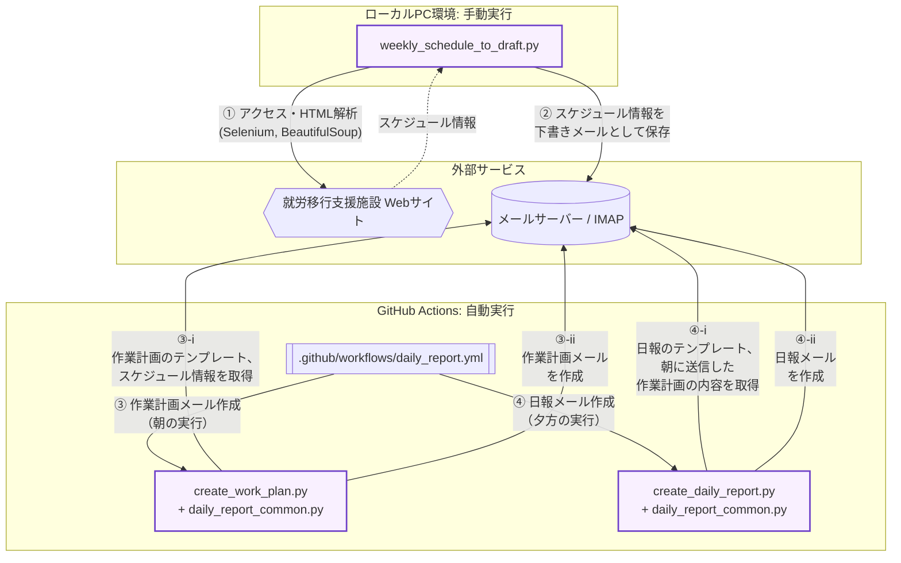

# 定型報告メールの自動作成ツール

## 概要
就労移行支援支援の訓練で毎日提出する作業計画メール、日報メールといった定型報告メールの下書きをGmailのドラフト内に自動作成するツールです。RPAの学習を兼ねて製作し、実際の訓練で毎日運用しています。開発プロセスにおいては、生成AI（Claude）をコーディング・アシスタントとして活用しました。要件定義、プロンプトの設計、出力コードの構造理解、環境構築および動作検証・デバッグを行いながら完成させました。

## 背景と目的
- 定型報告メールの内容には転記で済む部分がいくつかあり、自動化したかった。
- 転記ミスやメールの作成忘れといったミスを防ぎたかった。
- 訓練で実用できるツールであるため、学習のモチベーションになると思った。

## ディレクトリ構成と機能
```text
.
├── .github/
│   └── workflows/
│       └── daily_report.yml    # GitHub Actions定義（朝・夕の自動実行スケジュール）
├── create_daily_report.py      # 日報メール作成スクリプト（夕方実行）
├── create_work_plan.py         # 作業計画メール作成スクリプト（朝実行）
├── daily_report_common.py      # メール作成・IMAP処理などの共通モジュール
├── weekly_schedule_to_draft.py # 施設Webサイトからスケジュール情報を取得するスクリプト（ローカル手動実行）
└── README.md                   # 本ドキュメント
```

## 機能とファイル構成
1. スケジュール情報取得 (`weekly_schedule_to_draft.py`):  
就労移行支援施設のWebサイトにアクセスし、訓練スケジュールを取得・保存します。
2. 作業計画メールの生成 (`create_work_plan.py` / `daily_report_common.py`):  
下書き内のテンプレートに取得したスケジュール情報を自動挿入し、新規の作業計画メールを作成します。
3. 日報メールの生成 (`create_daily_report.py` / `daily_report_common.py`):  
朝送信した作業計画メールの内容を自動で抜粋・転記し、日報メールの下書きを作成します。
4. 定期実行処理 (`daily_report.yml`):  
GitHub Actionsを利用し、指定した時刻（朝・夕）に作業計画と日報の作成スクリプトを自動実行します。

## 使用技術
|項目|使用技術・環境|
|---|---|
|開発支援（AI）|Claude Sonnet 5.5|
|プログラミング言語|Python 3.13.9|
|ブラウザ操作|Selenium 4.48.0|
|HTML解析|Beautiful Soup4 0.0.2|
|メール操作|IMAP（Gmail）|
|定期実行|GitHub Actions|
|開発環境|Windows / PyCharm|
|Python実行環境|仮想環境（.venv）|


## 全体の流れ


## 工夫した点
#### 認証情報を残さない設計
就労移行支援施設の共用PCで実行するという前提があったため、ログイン操作を伴うプログラム(`weekly_schedule_to_draft.py`)は手動で実行するとともに、ログイン認証情報を共用PC上に保存しない方針にしました。また、Gmail操作に必要なユーザー認証情報についてはGitHubのSecretsに登録し、コードファイルから切り離しています。
#### スケジュール管理も兼ねている
就労移行支援施設のWebサイトからスケジュール情報を取得して使用するため、スケジュールの誤認（日付とスケジュール情報をちぐはぐに覚えてしまうなど）を防ぐ役割も果たします。
#### テンプレート方式
「【日報】テンプレ」「【作業計画】テンプレ」をもとに本文を生成し、書式を一定に保っています。

## 苦労した点・学んだこと
- Beautiful soup4単体ではログイン操作やセッション維持ができないということを知らず、WebページのHTML解析を実現するまでに時間がかかった。Seleniumと組み合わせることで解決した。
- オンスケジュールでプログラムが実行されない問題が起こった際、プログラムの不備なのかGitHub Actions側の障害などが原因なのかを判別するのに時間がかかった。[GitHub Status](https://www.githubstatus.com/)やネット上の記事を参照した結果、GitHub Actionsのスケジューラの遅延であるらしいことがわかった。

## 今後の改善
- スケジューラの遅延への対策。
- AIに渡したプロンプトが仕様書の体を成していなかったため、プロンプトの書き方についても改善したい。

## 運用状況
運用開始：2026年9月16日  
利用頻度：就労移行支援施設の通所日（月～金）  
効果：スケジュール情報の転記ミスがなくなった。週に20分程度の作業時間短縮。

## 注意事項
このリポジトリは公開用に整理したものです。認証情報、個人情報、就労移行支援施設の内部情報は含まれていません。認証情報やスクレイピング先のURLをコードから削除したため、そのまま実行しても動作はしません。
